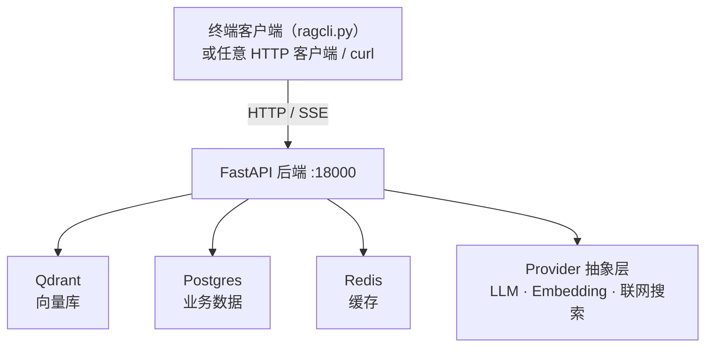
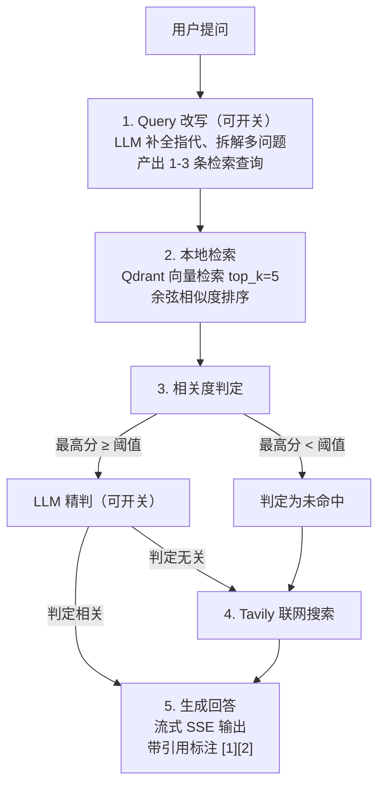

# RAG-LAB

一个 RAG 知识库问答系统：文档入库、本地检索、联网搜索兜底，
支持多用户与权限，Docker 一键部署。

---

## 目录

- [核心特性](#核心特性)
- [架构](#架构)
- [快速开始](#快速开始)
- [配置说明](#配置说明)
- [API 文档](#api-文档)
- [终端客户端](#终端客户端)
- [问答流程](#问答流程)
- [项目结构](#项目结构)
- [常见问题](#常见问题)

---

## 核心特性

**知识库**
- 支持 PDF / Word(.docx/.doc) / Markdown / TXT 文档
- 扫描件 PDF 自动 OCR（本地 RapidOCR，无需联网、无需额外服务）
- 中文友好的递归分块，避免切断句子
- 增量索引：上传即索引，支持重新索引、删除
- 索引进度可见（进行中/已就绪/失败），并自动补偿中断的索引任务
- 一个知识库对应一个向量集合，天然隔离

**问答（路线 C 混合式）**
- Query 改写：LLM 补全指代、拆解多问题
- 本地检索：向量相似度检索，非硬性 top-k
- 相关度判定：阈值粗筛 + LLM 精判（可开关）
- 联网兜底：本地无相关内容时自动联网（Tavily）
- 流式输出：SSE 逐字返回，带引用来源标注

**账户与权限**
- 管理员 / 普通用户两级角色
- 管理员增删改查用户、重置密码、禁用账户
- 知识库级细粒度授权（读 / 写）
- 全量审计日志

**双模式模型接入**
- LLM：DeepSeek API / 任意 OpenAI 兼容接口 / 本地 vLLM —— 改配置即切换
- Embedding：本地 BGE-M3（CPU）/ Embedding API —— 改配置即切换

---

## 架构



后端主要路由：

- `/api/auth` 登录、当前用户、改密码
- `/api/admin` 用户管理、系统配置、审计日志、统计
- `/api/kb` 知识库 CRUD、权限、文档上传、索引
- `/api/chat` 问答（流式/非流式）、会话管理
- `/api/health` 健康检查、配置概览

**Provider 抽象层**是本项目的架构核心：业务代码只依赖抽象接口，
底层实现（API 或本地模型）通过配置切换，无需改动任何业务逻辑。

---

## 快速开始

### 前置要求

- Docker 20.10+ 与 Docker Compose v2
- 至少 4GB 可用内存（BGE-M3 模型约 2GB）
- 至少 10GB 可用磁盘（含模型缓存与镜像）

### 步骤

**1. 准备配置**

```bash
cd RAG-LAB
cp .env.example .env
```

编辑 `.env`，至少填写：

```bash
# LLM（必填）
DEEPSEEK_API_KEY=sk-你的key

# 联网搜索（选填，不填则自动禁用该功能）
TAVILY_API_KEY=tvly-你的key

# 安全（务必修改）
SECRET_KEY=换成随机32位字符串
POSTGRES_PASSWORD=换成强密码
ADMIN_PASSWORD=换成强密码
```

生成随机密钥：

```bash
python3 -c "import secrets; print(secrets.token_urlsafe(32))"
```

**2. 启动**

```bash
./scripts/start.sh --build
```

首次启动会下载 BGE-M3 模型（约 2GB），耗时取决于网速，请耐心等待。

**3. 验证**

```bash
# 健康检查
python3 scripts/ragcli.py --health

# 查看 API 文档
# 浏览器打开 http://localhost:18000/docs
```

**4. 登录**

```bash
# 交互式问答
python3 scripts/ragcli.py

# 或指定账号
python3 scripts/ragcli.py -u admin -p 你的密码
```

### 停止与清理

```bash
docker compose stop              # 停止服务（保留数据）
docker compose down              # 停止并删除容器（保留数据卷）
docker compose down -v           # 彻底清理（含所有数据，慎用）
```

---

## 配置说明

全部配置项位于 `.env`，关键项说明：

### 模型配置（双模式核心）

```bash
# ---- LLM ----
LLM_PROVIDER=deepseek        # deepseek | openai_compatible | vllm_local
DEEPSEEK_API_KEY=sk-xxx
DEEPSEEK_MODEL=deepseek-chat

# 切换到本地 vLLM 时改为：
# LLM_PROVIDER=vllm_local
# VLLM_BASE_URL=http://host.docker.internal:8001/v1
# VLLM_MODEL=Qwen/Qwen2.5-7B-Instruct

# ---- Embedding ----
EMBEDDING_PROVIDER=local_bge   # local_bge | openai_compatible
BGE_MODEL_PATH=BAAI/bge-m3
BGE_DEVICE=cpu
BGE_NUM_THREADS=4
```

### 检索策略（可在 admin 后台动态调整）

```bash
RETRIEVAL_SCORE_THRESHOLD=0.50   # 相似度阈值，低于此值判定未命中
RETRIEVAL_TOP_K=5                # 检索返回条数
RETRIEVAL_LLM_JUDGE=true         # 是否启用 LLM 精判
QUERY_REWRITE_ENABLED=true       # 是否启用 Query 改写
WEB_SEARCH_AUTO_FALLBACK=true    # 未命中时是否自动联网
```

调参建议：

| 场景 | 调整 |
|---|---|
| 检索结果太少 | 降低 `RETRIEVAL_SCORE_THRESHOLD`（如 0.4） |
| 检索到无关内容 | 提高阈值（如 0.6），或开启 LLM 精判 |
| 答案不够全面 | 提高 `RETRIEVAL_TOP_K`（如 8） |
| 响应太慢 | 关闭 `RETRIEVAL_LLM_JUDGE`，减少一次 LLM 调用 |
| 省钱 | 关闭 `QUERY_REWRITE_ENABLED`（省一次调用） |

**注意**：修改 `.env` 需重启容器；在 admin 后台改配置则立即生效。

### 分块参数

```bash
CHUNK_SIZE=800        # 每块字符数
CHUNK_OVERLAP=150     # 相邻块重叠字符数
```

### OCR（扫描件 PDF）

当 PDF 提取不到任何文字（图片构成的扫描件）时，自动转 OCR 识别：

```bash
OCR_ENABLED=true      # 关闭则扫描件直接判为解析失败
OCR_MAX_PAGES=30      # 单文档最多 OCR 页数，防止超长文档拖垮 CPU
OCR_DPI=200           # 页面渲染分辨率，越高越准但越慢
```

引擎为 RapidOCR（PP-OCRv4 中文模型，纯 ONNX 推理，模型随包内置，约 15MB）。
CPU 推理约 1 秒/页，无需 GPU、无需联网、无需外部服务。

**注意**：OCR 在索引阶段异步执行，页数多时索引耗时会明显增加。
超过 `OCR_MAX_PAGES` 的页数会被忽略，日志中会有提示。

经验值：中文技术文档 500-800，叙述性文档 800-1200。
重叠一般设为块大小的 15%-20%，避免信息在切分处丢失。

---

## API 文档

服务启动后访问 `http://localhost:18000/docs` 查看交互式文档（Swagger UI）。

### 主要接口

**认证**

| 方法 | 路径 | 说明 |
|---|---|---|
| POST | `/api/auth/login` | 登录获取 JWT |
| GET | `/api/auth/me` | 当前用户信息 |
| POST | `/api/auth/change-password` | 修改自己密码 |

**知识库**

| 方法 | 路径 | 说明 |
|---|---|---|
| GET | `/api/kb` | 知识库列表（按权限过滤） |
| POST | `/api/kb` | 创建知识库 |
| PATCH | `/api/kb/{id}` | 修改知识库 |
| DELETE | `/api/kb/{id}` | 删除知识库（含文档与向量） |
| POST | `/api/kb/{id}/documents` | 上传文档（multipart） |
| GET | `/api/kb/{id}/documents` | 文档列表 |
| DELETE | `/api/kb/{id}/documents/{doc_id}` | 删除文档 |
| POST | `/api/kb/{id}/documents/{doc_id}/reindex` | 重新索引 |
| POST | `/api/kb/{id}/permissions` | 授权用户（管理员） |

**问答**

| 方法 | 路径 | 说明 |
|---|---|---|
| POST | `/api/chat/ask` | 提问（返回完整答案） |
| POST | `/api/chat/stream` | 提问（SSE 流式） |
| POST | `/api/chat/retrieve` | **纯检索**（不调用 LLM，返回片段与分数） |
| GET | `/api/chat/sessions` | 我的会话列表 |
| GET | `/api/chat/sessions/{id}` | 会话历史 |
| DELETE | `/api/chat/sessions/{id}` | 删除会话 |

**管理**

| 方法 | 路径 | 说明 |
|---|---|---|
| GET | `/api/admin/users` | 用户列表（分页/搜索） |
| POST | `/api/admin/users` | 新增用户 |
| PATCH | `/api/admin/users/{id}` | 修改用户 |
| POST | `/api/admin/users/{id}/reset-password` | 重置密码 |
| DELETE | `/api/admin/users/{id}` | 删除用户 |
| GET | `/api/admin/config` | 读取系统配置 |
| PUT | `/api/admin/config` | 更新系统配置（立即生效） |
| GET | `/api/admin/stats` | 系统统计 |
| GET | `/api/admin/audit-logs` | 审计日志 |

### 使用示例

```bash
# 登录
TOKEN=$(curl -s -X POST http://localhost:18000/api/auth/login \
  -H "Content-Type: application/json" \
  -d '{"username":"admin","password":"admin123456"}' \
  | python3 -c "import sys,json; print(json.load(sys.stdin)['access_token'])")

# 创建知识库
curl -s -X POST http://localhost:18000/api/kb \
  -H "Authorization: Bearer $TOKEN" \
  -H "Content-Type: application/json" \
  -d '{"name":"公司制度","description":"员工手册与规章制度"}'

# 上传文档
curl -s -X POST http://localhost:18000/api/kb/<KB_ID>/documents \
  -H "Authorization: Bearer $TOKEN" \
  -F "file=@员工手册.pdf"

# 提问
curl -s -X POST http://localhost:18000/api/chat/ask \
  -H "Authorization: Bearer $TOKEN" \
  -H "Content-Type: application/json" \
  -d '{"query":"年假有多少天","kb_id":"<KB_ID>"}'
```

---

## 终端客户端

`scripts/ragcli.py` 是纯标准库实现的终端客户端，朋友无需安装任何依赖即可使用。

### 基本用法

```bash
# 交互式问答（推荐）
python3 scripts/ragcli.py --host http://服务器IP:18000

# 指定账号免输入
python3 scripts/ragcli.py --host http://服务器IP:18000 -u zhangsan -p 密码

# 单次提问（适合脚本集成）
python3 scripts/ragcli.py --host http://服务器IP:18000 \
  -u zhangsan -p 密码 --ask "报销流程是什么"

# 检查服务状态
python3 scripts/ragcli.py --host http://服务器IP:18000 --health
```

### 交互模式命令

```
/help            显示帮助
/kb              列出并选择知识库
/kb 制度         按名称切换知识库
/web on|off      开启/关闭联网搜索
/new             开始新会话
/sources         查看上一条回答的引用来源
/quit            退出
```

### 管理员命令

```bash
# 列出所有用户
python3 scripts/ragcli.py --host http://IP:18000 -u admin -p 密码 --list-users

# 创建用户
python3 scripts/ragcli.py --host http://IP:18000 -u admin -p 密码 \
  --create-user lisi 密码123

# 系统统计
python3 scripts/ragcli.py --host http://IP:18000 -u admin -p 密码 --stats
```

### 分发给朋友

把 `scripts/ragcli.py` 单个文件发给他们即可，只要有 Python 3.8+ 就能运行：

```bash
python3 ragcli.py --host http://你的公网IP:18000
```

---

## 问答流程



**为什么不是硬性 top-k**：固定返回 5 条会导致"知识库里没有，但硬凑 5 条无关内容"
污染 LLM 的回答。本项目用阈值 + 精判双重把关，宁可判定未命中走联网，也不给模型喂垃圾。

---

## 项目结构

```
RAG-LAB/
├── app/
│   ├── main.py                    FastAPI 入口，路由注册，生命周期
│   ├── core/
│   │   ├── config.py              配置加载（pydantic-settings）
│   │   ├── database.py            异步数据库引擎与会话
│   │   └── security.py            密码哈希 + JWT
│   ├── models/
│   │   └── db.py                  SQLAlchemy ORM（9 张表）
│   ├── providers/                 ★ 抽象层：可替换的实现
│   │   ├── llm/
│   │   │   ├── base.py             BaseLLM 接口 + get_llm 工厂
│   │   │   └── openai_compat.py   OpenAI 兼容实现（DeepSeek/vLLM/其他）
│   │   ├── embedding/
│   │   │   └── base.py            BaseEmbedding + BGE-M3 本地实现 + 工厂
│   │   ├── vector/
│   │   │   ├── base.py            BaseVectorStore + get_vector_store 工厂
│   │   │   └── qdrant_store.py    Qdrant 实现
│   │   └── websearch/
│   │       └── base.py            BaseWebSearch + Tavily 实现 + 工厂
│   ├── services/
│   │   ├── document_parser.py     PDF/Word/MD/TXT 解析 + 扫描件 OCR + 中文分块
│   │   ├── indexing.py            索引流程：解析→分块→向量化→入库 + 中断补偿
│   │   ├── rag_engine.py          ★ RAG 核心：改写→检索→判定→联网→生成
│   │   ├── runtime_config.py      运行时配置（后台改配置立即生效）
│   │   └── bootstrap.py           初始化管理员与默认配置
│   ├── api/
│   │   ├── deps.py                认证与权限依赖
│   │   ├── auth.py                认证路由
│   │   ├── admin.py               管理端路由
│   │   ├── kb.py                  知识库路由
│   │   ├── chat.py                问答路由
│   │   └── system.py              健康检查、配置概览
│   ├── schemas/
│   │   └── api.py                 Pydantic 请求/响应模型
│   └── utils/
│       └── audit.py               审计日志（SAVEPOINT 隔离，失败不影响业务）
├── scripts/
│   ├── start.sh                   一键启动
│   ├── ragcli.py                  终端客户端（纯标准库）
│   ├── e2e_test.py                端到端集成测试（26 项断言）
│   ├── test_stream.py             SSE 流式问答验证
│   ├── test_query_rewrite.py      Query 改写与相关度判定验证
│   ├── selfcheck.py               静态自查
│   └── verify_core.py             核心逻辑验证（46 项断言）
├── test_fixtures/                 测试用示例文档（PDF/Word/MD/TXT，供 e2e 使用）
├── data/
│   ├── uploads/                   上传文档（挂载卷）
│   ├── logs/                      日志（app.log，10MB 轮转）
│   └── hf_cache/                  BGE 模型缓存
├── Dockerfile
├── docker-compose.yml
├── docker-compose.dev.yml         开发模式（代码热重载）
├── requirements.txt
├── .env.example
└── README.md
```

---

## 常见问题

### 服务启动后一直不健康

首次启动需要下载 BGE-M3 模型（约 2.2GB），观察日志：

```bash
docker compose logs -f backend
```

看到 `Application startup complete` 即为就绪。

若卡在 `Network is unreachable`：容器内无法访问 huggingface.co。项目默认已配置
`HF_ENDPOINT=https://hf-mirror.com`（国内镜像）。海外服务器可在 `.env` 中注释掉该行，
或改为官方源。验证镜像可达：

```bash
docker exec rag-lab-backend curl -s -o /dev/null -w "%{http_code}\n" https://hf-mirror.com
# 期望输出 200
```

### 健康检查显示 degraded 而不是 ok

`degraded` 是**正常的降级状态**，不是故障。它表示向量库正常、但 LLM 或 Embedding 未就绪：

```bash
curl -s localhost:18000/api/health | python3 -m json.tool
```

```
status: degraded          ← 向量库OK，LLM或Embedding未就绪
llm_model: "未就绪: ..."   ← 具体原因会写在里面
embedding_dim: 1024        ← 模型已加载
vector_store_ok: true
web_search_enabled: false  ← 联网搜索是否真正可用
warnings: [...]            ← 配置层面的告警（见下）
```

`warnings` 会明确列出"看着能用其实没配"的项，例如：

```
warnings: ["联网搜索已启用兜底(WEB_SEARCH_AUTO_FALLBACK=true)但 provider 不可用
           （tavily，未配置 TAVILY_API_KEY），知识库未命中时无法联网补充"]
```

**重要**：LLM 未配置时，检索链路仍然完全可用。你可以用纯检索接口验证知识库：

```bash
curl -X POST localhost:18000/api/chat/retrieve \
  -H "Authorization: Bearer $TOKEN" \
  -H "Content-Type: application/json" \
  -d '{"query":"年假有多少天","kb_id":"<KB_ID>"}'
```

这个接口不调用 LLM，直接返回命中的片段与相似度分数，适合调试检索质量。

### 问答报错 503 "LLM 未就绪"

这是**配置问题，不是 bug**。响应里会写明具体原因，通常是：

```
LLM 未就绪，无法生成回答：LLM_PROVIDER=deepseek 但未配置 DEEPSEEK_API_KEY。
请在 .env 中配置 API key，或仅使用检索功能。
```

按提示在 `.env` 填入 `DEEPSEEK_API_KEY` 后重启：

```bash
docker compose restart backend
```

### 知识库删除了但向量还占空间

正常情况下删除知识库会同时清理 Qdrant 集合。若因异常中断导致残留：

```bash
# 查看所有集合
curl -s localhost:6333/collections | python3 -m json.tool

# 手动删除某个残留集合
curl -X DELETE localhost:6333/collections/<collection_name>
```

### 上传文档后状态一直是 failed

查看具体错误：

```bash
curl -H "Authorization: Bearer $TOKEN" \
  http://localhost:18000/api/kb/<KB_ID>/documents | python3 -m json.tool
```

`error_message` 字段会说明原因。常见情况：

- 扫描件 PDF 且 OCR 也识别不出文字 → 检查文件清晰度，或转为文字版；确认 `OCR_ENABLED=true`
- 扫描件页数超过 `OCR_MAX_PAGES` → 提高该值后重新索引
- `.doc` 格式缺少 antiword → 转为 `.docx` 上传
- 文件损坏或加密

### 检索总是判为未命中

说明知识库内容与问题语义差距大，或阈值过高。调试步骤：

```bash
# 1. 查看分块是否正常
curl -H "Authorization: Bearer $TOKEN" \
  "http://localhost:18000/api/kb/<KB_ID>/documents/<DOC_ID>/chunks"

# 2. 降低阈值试试（admin 后台或直接改 .env）
RETRIEVAL_SCORE_THRESHOLD=0.35

# 3. 关闭 LLM 精判，看是否为精判误判
RETRIEVAL_LLM_JUDGE=false
```

### 联网搜索不生效

检查 `TAVILY_API_KEY` 是否填写，以及：

```bash
python3 scripts/ragcli.py --health
# 联网搜索一行会明确标注是否可用：✓ / ✗ 不可用
```

若显示 `NullWebSearch ✗ 不可用`，说明 key 未配置。健康检查的 `warnings`
字段会给出具体原因（例如"已启用兜底但 provider 不可用"），
启动日志中也有对应 WARNING。

**注意**：`WEB_SEARCH_AUTO_FALLBACK=true` 但未配 key 时，知识库未命中会
直接返回"无法回答"，不会联网补充。要么配 key，要么把该开关关掉。

### 内存占用过高

BGE-M3 模型常驻约 2GB。若机器内存紧张：

```bash
# 改用 Embedding API，省下 2GB
EMBEDDING_PROVIDER=openai_compatible
```

或减少 CPU 线程数：

```bash
BGE_NUM_THREADS=2
```

### 如何让朋友访问

1. 服务器防火墙开放 18000 端口
2. 把 `ragcli.py` 发给朋友
3. 朋友执行：`python3 ragcli.py --host http://你的公网IP:18000`

**上线建议**：前置 Nginx 配置 HTTPS，用域名而非裸 IP。
直接暴露 18000 端口到公网时务必修改所有默认密码和 `SECRET_KEY`。

---

## 安全清单

部署到公网前请逐项确认：

- [ ] 修改 `SECRET_KEY`（用 `secrets.token_urlsafe(32)` 生成）
- [ ] 修改 `ADMIN_PASSWORD`，并登录后再次修改
- [ ] 修改 `POSTGRES_PASSWORD`
- [ ] 数据库端口 5432、Qdrant 端口 6333 **不要**暴露到公网
- [ ] 配置 HTTPS（Nginx + Let's Encrypt）
- [ ] 定期备份 `rag-lab-pgdata` 与 `rag-lab-qdrant-data` 数据卷
- [ ] 检查 `docker compose logs` 无异常
